  

<h1 align="center">AEAEA Technologies</h1>

<h3 align="center">
  Bridging Gaps in Higher Education Through Technology
</h3>

  Building tailored technology solutions that simplify academic workflows,
  empower educational institutions, and improve operational efficiency.

  
  &nbsp;
  

---

## 🏢 About Us

**AEAEA Technologies** develops customized technology solutions for educational institutions, helping them address real-world academic, administrative, and operational challenges.

We believe technology should adapt to institutional needs—not force institutions to adapt to rigid software.

Our goal is to simplify complex workflows, improve efficiency, and build practical digital solutions that evolve alongside educational institutions.

## 🎯 What We Do

<table>
  <tr>
    <td width="50%" valign="top">
      <h3>🎓 EdTech Solutions</h3>
      Digital platforms designed to support academic processes, teaching, learning, and institutional needs.
    </td>
    <td width="50%" valign="top">
      <h3>⚙️ Workflow Automation</h3>
      Technology that reduces repetitive manual work and streamlines academic and administrative operations.
    </td>
  </tr>
  <tr>
    <td width="50%" valign="top">
      <h3>📊 Analytics & Dashboards</h3>
      Reporting and visualization tools that help institutions understand performance and make informed decisions.
    </td>
    <td width="50%" valign="top">
      <h3>📚 Accreditation Support</h3>
      Digital workflows for organizing documentation and supporting accreditation-related reporting.
    </td>
  </tr>
</table>

## 🚀 Our Product

### 📝 [SirC Quiz](https://sircquiz.aeaeatech.com/)

SirC Quiz is an academic assessment platform designed to help faculty create, assign, and manage quizzes for students.

Our goal is to simplify digital assessments and support the needs of educational institutions.

**Key focus areas:**

- 📝 Quiz creation and assignment
- 🎓 Faculty and student assessment workflows
- 📊 Student performance and result management
- 🔒 Assessment integrity and controlled quiz environments
- 🏫 Institution-oriented workflows

  

## 🛠️ Our Engineering Principles

| Principle | Our Approach |
|---|---|
| 🎯 Purpose-driven | Solve meaningful, real-world problems. |
| 📈 Scalable | Design software that can evolve with growing needs. |
| 🔒 Security-conscious | Follow appropriate security and privacy practices. |
| ✅ Reliable | Prioritize testing, maintainability, and stability. |
| 👥 User-focused | Build around the needs of faculty, students, and administrators. |

## 💻 Engineering & Collaboration

This GitHub organization is the home for our software repositories, product development, testing initiatives, and technical documentation.

We value:

- Clean, maintainable code
- Thoughtful system architecture
- Collaborative development
- Quality assurance and continuous improvement
- Responsible handling of data and security

## 🤝 Let's Connect

We welcome conversations with educational institutions, technology professionals, and potential collaborators interested in building practical technology solutions.

  <a href="https://aeaeatech.com/">
    <strong>🌐 Official Website</strong>
  </a>
  &nbsp; • &nbsp;
  <a href="https://sircquiz.aeaeatech.com/">
    <strong>📝 Explore SirC Quiz</strong>
  </a>

---

  <strong>AEAEA Technologies</strong>
   
  Building technology around institutional needs.

